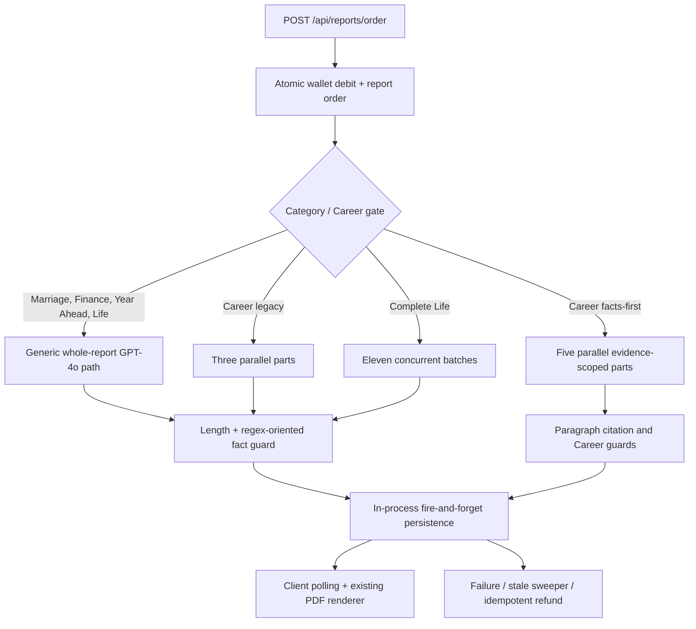
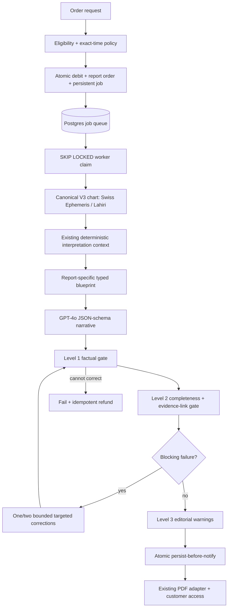

# Universal paid-report engine: audit, architecture and rollout

Status: feature branch implementation; not merged, deployed, or enabled. This document distinguishes repository evidence from hypotheses and mocked/offline verification from live reliability.

## A. Product inventory

The active catalogue is seeded by `server/migrate.ts`; pricing is read from the catalogue unless `FEATURE_RELEASE_B_PRICING` is enabled. `Life Reading` remains supported by code and historical rows but is not currently seeded as a new active product. Kundli PDF, Ask, daily horoscope, matching, consultations and pooja/store purchases are separate products, not paid-report catalogue entries.

| Product | Slug / category | Current price | Endpoint | Legacy generation | Universal plan | PDF / delivery | Time policy |
|---|---|---:|---|---|---|---|---|
| Complete Life Report | `complete-life-report` / `life_complete` | ₹1,499 (₹999 with Release B) | `POST /api/reports/order` | 11 concurrent GPT-4o batches; at least 90% sections | 46 sections in 6 bounded calls | existing generic client PDF; persisted JSON; poll/notification | exact required |
| Career & Profession Report | `career-report` / `career` | ₹299 | same | legacy 3-part path; gated facts-first 5-part path | registry and shared durable lifecycle; retained facts-first evidence/synthesis adapter | existing premium Career PDF | exact required |
| Marriage & Love Report | `marriage-report` / `marriage` | ₹349 (₹299 with Release B) | same | one full GPT-4o draft and one possible full redraft | one schema-constrained call; targeted failed-section correction | existing generic client PDF | exact required |
| Wealth & Finance Report | `finance-report` / `finance` | ₹299 | same | same generic path | same shared engine, finance blueprint | existing generic client PDF | exact required |
| Year Ahead Report | `year-ahead-report` / `year_ahead` | ₹499 | same | same generic path with transit text | same shared engine with as-of transit evidence | existing generic client PDF | exact required |
| Life Reading Report | historical/code-only / `life` | catalogue-defined when present | same | generic path | one shared call; stable facts only when time is approximate | existing generic client PDF | approximate allowed with houses/vargas/timing withheld |

All products keep the existing order, debit, entitlement, refund, persistence and customer polling contracts. Historical stored report payloads are not rewritten.

## B. Existing architecture

## C. Root-cause findings

Confirmed from code and regression fixtures:

1. Three orchestration systems implement different completeness, retry and cost behavior. Only facts-first Career had a hard per-report ledger and six-minute deadline.
2. Generic reports redraft the whole report after a rejected section. Complete Life retries rejected headings within each batch but may still deliver with up to 10% missing.
3. Generic validation mixes factual checks and minimum length. Editorial constraints in the Career path can become delivery blockers. This causes unnecessary correction work and makes failures hard to classify.
4. Bare citation IDs do not demonstrate how a fact supports an interpretation. Conversely, paragraph-scoped Career citation rules can reject a legitimate shared synthesis when the paragraph does not enumerate every contributing assessment.
5. The legacy answer guard treated a named yoga/dosha topic as a positive assertion and only detected negation before the name. Predicate negation such as “Mangal Dosha is not present” could therefore be misclassified. The shared grammar helper now handles negation before or after the named condition.
6. Year Ahead and Complete Life previously received transit text in their legacy prompts, but the first universal blueprint draft did not create structured transit evidence. The blueprint now calculates dated transit evidence from the canonical chart.
7. Model-authored remedies were accepted after general prose validation in the generic legacy path. The universal path ignores model remedies and attaches only deterministic chart remedies.
8. Generation was a process-local promise. The HTTP request returned quickly, but a restart lost the work; the 30-minute sweeper later refunded it. No persistent claim or job record existed.
9. Payment and refund operations are already strong: debit/order creation is transactional, delivery updates only a processing order, and refund credit is guarded by `refunded_at` in a transaction.
10. Existing client PDFs are render-only and historical payload-compatible. The generic renderer lacked the Career renderer’s explicit unsupported-script rejection; it now performs the same preflight instead of silently dropping text.

Hypotheses requiring controlled live evaluation:

- Actual GPT-4o prose quality and schema adherence across adversarial charts.
- Real provider latency and correction frequency, especially for the 46-section Complete Life product.
- Whether one call gives enough editorial depth for every standard product within the configured output allowance.
- Whether the generic PDF’s visual density remains premium enough for long live prose; offline layout tests prove rendering, not editorial quality.

## D. Universal architecture

The typed registry owns report identity, required data and vargas, evidence domains/modules, sections, prompt limits, validation policy, renderer, delivery policy and approximate-time policy. Standard products use one call; Complete Life uses six groups of at most eight sections; Career keeps its richer deterministic Career ledger/synthesis as an adapter behind the same registry and durable delivery lifecycle.

The persistent job table uses `queued → generating → completed|failed` while the existing customer-visible order remains `processing → ready|failed`. This avoids breaking clients. Queued work survives restarts and claims are mutually exclusive. An in-flight job is not automatically replayed after a worker crash because the provider charge may already have occurred; the existing stale sweep fails and refunds it. This is a deliberate safety limit and means full mid-call restart recovery is not yet proven.

## E. Validator matrix

| Check | Legacy status | Universal status | Delivery effect |
|---|---|---|---|
| Canonical chart/version | retained | retained before any call | blocking |
| Incorrect planet/sign/house, dasha date, yoga/dosha, varga claim | retained shared guard | retained | blocking |
| Approximate-time restrictions | retained | registry + blueprint + guard | blocking |
| Strict structured response | JSON object only | OpenAI strict JSON Schema + Zod strict parse | blocking; one format retry |
| Required sections / depth | inconsistent; Complete Life allowed omissions | typed per-product required sections and minimum depth | blocking |
| Evidence support | prose/paragraph rules vary | section evidence IDs plus explicit evidence→conclusion explanations | blocking |
| Unknown/out-of-scope evidence IDs | Career-only | all universal products | blocking |
| Whole-report correction | generic legacy | removed | none |
| Targeted failed-section correction | Career and Complete Life variants | common bounded policy; accepted sections preserved | blocking after limit |
| Model-authored remedies | generally allowed after prose guard | discarded | deterministic remedies only |
| Repetition, generic phrasing, paragraph length | sometimes blocking | warnings/metrics only | non-blocking |
| Regex exceptions as evidence | legacy guard retained for concrete factual contradictions | not used as the support model; structured links establish support | factual guard only |

## F. Implementation surface

Created:

- `server/reportEngine/{types,registry,blueprint,prompt,runtime,validation,engine,feature,jobs,index}.ts`
- `tests/unit/universal-report-{engine,pdf,jobs}.test.ts`
- `scripts/universal-report-samples.ts`
- this document

Modified narrowly:

- schema/migration/storage for persistent jobs
- order route and startup for the gated durable worker
- feature and audit registries
- report quality helper extraction and the generic yoga/dosha negation defect
- existing AI service exports used by the adapter
- generic PDF pure renderer and unsupported-script preflight
- report fulfillment outcome reporting, without changing debit/refund rules

## G. Migration status

| Category | Registry | Blueprint/evidence | Shared runtime/validation | Durable lifecycle | PDF verified | Status |
|---|---:|---:|---:|---:|---:|---|
| Career | yes | existing richer Career ledger/synthesis | adapter retains Career budget/guards | yes | premium renderer | implemented; live prose not evaluated here |
| Marriage | yes | yes | yes | yes | generic renderer | implemented |
| Finance | yes | yes | yes | yes | generic renderer | implemented |
| Year Ahead | yes | yes, including dated transits | yes | yes | generic renderer | implemented |
| Life | yes | stable-fact policy | yes | yes | generic renderer | implemented; code/historical product |
| Complete Life | yes, 46 sections | section-specific planet/house/yoga/dosha/transit/dasha/remedy scopes | six bounded groups | yes | generic renderer | implemented; live depth/latency evaluation required |

## H–J. Verification and offline artifacts

The offline generator writes JSON and PDF for all six categories to `/private/tmp/navagraha-universal-report-samples`. It makes zero paid calls. The prose is deterministic fixture prose and is explicitly watermarked for Career; it proves orchestration, validation, completeness, persistence shape and PDF renderability, not GPT-4o writing quality or production reliability.

| Category | Sections | PDF pages | Simulated calls | Simulated cost |
|---|---:|---:|---:|---:|
| Career | 9 including appendix/glossary | 9 | 5 | $0.042392 |
| Marriage | 8 | 5 | 1 | $0.017565 |
| Finance | 8 | 6 | 1 | $0.019818 |
| Year Ahead | 8 | 6 | 1 | $0.023388 |
| Life | 6 | 5 | 1 | $0.026925 |
| Complete Life | 46 | 18 | 6 | $0.123772 |

Automated coverage includes every registry product and renderer, seven synthetic Career charts, different natal configurations, historical dates in the existing canonical suite, exact/approximate policies, transit evidence, scoped long-report evidence, malformed/truncated/provider-error behavior, targeted correction success/failure, unsupported evidence, deterministic remedies, deadlines, budget exhaustion, persistent-worker terminal behavior, unsupported scripts and all pre-existing payment/refund/report compatibility tests.

Pre-production verification used an isolated PostgreSQL 14 cluster at `127.0.0.1:55439` with a disposable database. The 12 previously skipped database files passed all 116 tests serially. Six additional database tests verify atomic debit/order/job creation, insufficient-funds rollback, concurrent duplicate submission, `FOR UPDATE SKIP LOCKED` worker exclusion, queued-job pickup after worker absence, stale in-flight failure/refund, delivery-versus-refund races, and idempotent finalisation. Route tests verify all six products enter the universal queue only when both the feature flag and verified-email allowlist match, while all six remain on the legacy path with the flag disabled.

Final local result after this verification: TypeScript check passed; production build passed; Vitest passed 110 files / 1,705 tests with no skipped database tests. The generic renderer was instrumented to prove that every configured heading is drawn, all text stays inside the page footer boundary, long paragraphs and place names paginate, missing birth fields render, and unsupported scripts are rejected. Text extraction from the six offline PDFs found every required heading and no empty page.

No staging/test OpenAI credential was available in the verification environment. Therefore no live GPT-4o request was made, and actual provider token use, cost, latency, correction rate, narrative quality and schema compliance remain unmeasured. The manifest figures below are simulated usage from deterministic fixture responses and must not be presented as live-provider metrics.

## K. Cost and latency policy

`gpt-4o` is costed at $2.50 per million input tokens and $10 per million output tokens, matching the [published GPT-4o API rates](https://developers.openai.com/api/docs/models/gpt-4o). Every universal request first reserves a conservative worst case using UTF-8 byte count as an upper bound for input tokens plus its complete output allowance. A call is refused before dispatch if spent + reserved would exceed 250,000 microdollars. Missing usage is charged at the full reservation. Provider usage settles the reservation; transport, format and targeted correction calls share the same ledger. No fallback call exists outside it.

Offline duration is not representative of provider latency. The unchanged six-minute report deadline and 120-second per-call timeout remain. Metrics persist inside successful universal report content and record calls, transport/format retries, corrections, cost, duration and editorial warnings. Career continues to expose its existing richer metrics callback.

## L. Remaining risks and limitations

1. No non-production OpenAI credential was present. Mocked narratives cannot prove premium live writing quality, real schema compliance, latency or true correction rates. Controlled non-production GPT-4o evaluation is still required and is a production blocker.
2. In-flight provider work is not replayed after a process crash because spend cannot be proved; it safely refunds after the existing stale timeout. Queued jobs do survive restarts. Full mid-call resumption would require persistent per-call spend reservations/checkpoints.
3. The generic renderer is preserved rather than redesigned. Automated bounds checks, text extraction and local page rasterisation pass, but the in-app browser connection was unavailable. Complete Life still needs browser review with actual GPT prose before rollout.
4. Universal metrics are stored with successful content; failed-attempt aggregate analytics are logged but do not yet have a dedicated reporting table.
5. The interpretation layer deliberately reuses only existing deterministic rules. Additional practitioner-reviewed rules need identifiers, applicability tests and sources before being added.
6. English/Latin-script PDF output is explicit. Unsupported scripts are rejected visibly; localization is not silently simulated.
7. No production reliability claim is made and the engine remains doubly gated, off and empty-allowlist by default.

## M. Controlled rollout and rollback

1. Keep `FEATURE_UNIVERSAL_REPORT_ENGINE` false and `UNIVERSAL_REPORT_ENGINE_ALLOWLIST` empty through review and migration verification.
2. Deploy code/schema with the gate off; verify legacy orders, historical report opening/downloading, health and migrations.
3. Enable only in a non-production environment with a non-production OpenAI credential. Run the six-product matrix and inspect actual narratives/PDFs/cost/latency.
4. In production, enable the flag only with one verified authorized test email in `UNIVERSAL_REPORT_ENGINE_ALLOWLIST`; keep the legacy path for everyone else.
5. Review generation quality, evidence links, all dates, PDFs, metrics, payment and refunds. Expand the allowlist only after explicit approval.
6. Roll back instantly by disabling the flag. Existing universal reports remain readable because the stored payload and PDF adapters are backward-compatible. Queued jobs should be drained or explicitly failed/refunded before removing worker code.

## Public architectural references

Only public concepts were used; no external report prose, private API, or source code was copied. The design follows the publicly documented separation of calculation from interpretation and report-ready signals described by [Modern Panditji](https://modernpanditji.com/methodology) and [PanditOne](https://panditone.com/learn/engine-method/panditone-engine-overview), the curated corpus/reproducibility emphasis described by [Melooha](https://www.melooha.com/blog/gen-ai---the-corpus-technology), and the computation/product/application separation visible in [OpenJyotish](https://github.com/velteyn/OpenJyotish) and [DaivAI](https://github.com/master12coder/daiv-ai). OpenJyotish is GPL-licensed, so its implementation was treated as reference material only and not incorporated.
